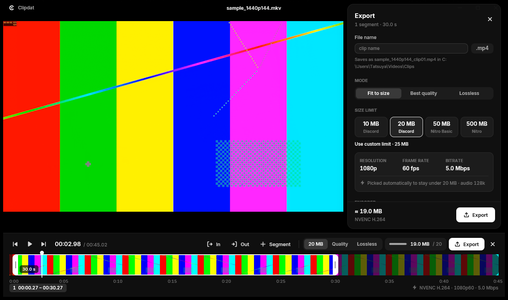
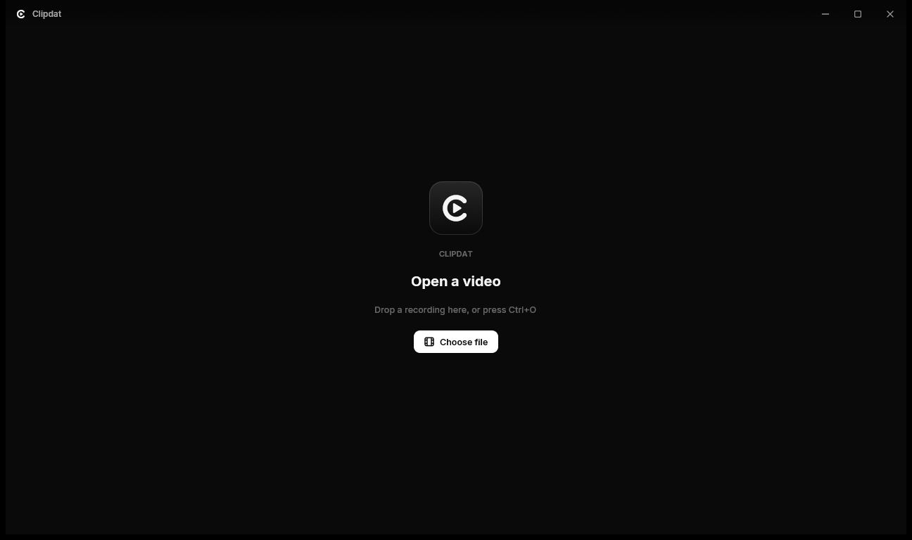

  

<h1 align="center">Clipdat</h1>

  <b>Clip it. Fit it. Paste it.</b> 
  A fast, native video player for Windows that turns your gaming recordings into Discord-ready clips in seconds.

  <a href="../../releases/latest"><b>Download for Windows</b></a> ·
  <a href="#features">Features</a> ·
  <a href="#keyboard-shortcuts">Shortcuts</a> ·
  <a href="#faq">FAQ</a>

  

---

You just hit the best play of your night. Open the recording in Clipdat, press **C**, drag the handles around the moment and press **E**. A few seconds later the clip is under Discord's upload limit and already on your clipboard. Press **Ctrl+V** in Discord and it's posted.

There are no upload sites, no re-encoding guesswork, and no 400 MB files to trim by hand.

## Features

### A player you'll actually keep as your default
- Plays practically anything (MKV, MP4, MOV, WebM, TS, AVI and more) with **hardware decoding**, smooth even at 1440p 144 fps.
- A clean, borderless window with a floating controller that gets out of the way.
- Thumbnail previews when you hover the seek bar, and frame-by-frame stepping.
- Light on your PC: the interface uses about 85 MB of memory and almost no CPU while you watch.

### Clipping in the same window
- Press **C** to slide in the timeline: a thumbnail strip with in/out handles you can grab.
- **Multiple segments** per video. Export them merged into one clip, or as separate files.
- Mark in and out with **I** / **O** while the video plays, and nudge frame by frame with **,** and **.**

### Exports that always fit
| Mode | What it does |
|---|---|
| **Fit to size** (default) | Pick 10, 20, 50 or 500 MB, or your own limit. Clipdat picks the best resolution and frame rate the size allows, encodes, **checks the result** and re-encodes once if it's over. You never get a file that's too big. |
| **Best quality** | Constant quality, at whatever size that takes. |
| **Lossless** | Cuts without re-encoding, nearly instantly, with zero quality loss. |

- **NVIDIA NVENC** H.264, HEVC and AV1. Decoding, scaling and encoding all happen on the GPU, many times faster than real time.
- **After export** the file is copied to your clipboard, ready for Discord, Slack or any other chat app.
- **Advanced options** for power users:
  - **Encoding:** rate control, encoder presets, adaptive quantization, B-frames, keyframe interval, 10-bit
  - **Picture:** crop to vertical (9:16) or square, HDR→SDR tone mapping
  - **Audio:** pick and mix audio tracks (game + mic), loudness normalization
  - **Workflow:** saved presets, and a live preview of the exact FFmpeg command

  

## Install

1. Download **`Clipdat-Setup-x.y.z.exe`** from the [latest release](../../releases/latest).
2. Run it. It installs just for you: no admin rights needed, nothing else to install.
3. On the last page, tick **Make Clipdat my default video player** if you want videos to open in it.

Updating is the same as installing: run the new setup. To uninstall, go to **Settings → Apps → Clipdat**.

There's also a **portable zip** if you'd rather not install anything. Extract it anywhere and run `clipdat.exe`.

> **"Windows protected your PC"?** Clipdat isn't code-signed yet, so SmartScreen doesn't recognize it. Click **More info → Run anyway**.

### Requirements
- Windows 10 (1809 or newer) or Windows 11, 64-bit
- An **NVIDIA GeForce GTX 10-series or newer** to export. AV1 export needs an RTX 40-series. Playback works on any GPU.

## Keyboard shortcuts

| Key | Action | | Key | Action |
|---|---|---|---|---|
| `Space` | Play / pause | | `C` | Clip mode |
| `←` `→` | Seek 5 s (`Shift`: 1 s) | | `I` / `O` | Set in / out |
| `,` `.` | Previous / next frame | | `N` | New segment |
| `↑` `↓` | Volume | | `Del` | Delete segment |
| `M` | Mute | | `E` | Export |
| `F` | Fullscreen (or double-click) | | `Ctrl+E` | Quick export with your last settings |
| `Ctrl+O` | Open file | | `Ctrl+,` | Settings |
| `Esc` | Close panel / leave clip mode | | | |

You can also drop a file onto the window, drag the video to move the window, and scroll over the video to change the volume.

## FAQ

**Which codec should I pick for Discord?**
**H.264**, the default. It plays inline everywhere: desktop, browser and mobile. HEVC and AV1 give better quality per MB, but not every Discord client plays them inline.

**Why does my lossless clip start a little early?**
A cut without re-encoding can only start on a keyframe. The timeline shows exactly how far the start will move back. If you need it frame-exact, use Fit to size or Best quality.

**My clip is long. Will it still fit in 20 MB?**
Clipdat lowers the resolution and frame rate step by step (1080p60 → 720p60 → 720p30…) to keep the clip watchable. If even the lowest step would look bad, it tells you before you export, so you can trim the clip or raise the limit.

**Does it support AMD or Intel GPUs?**
They work for playback today. Exporting with AMD and Intel encoders is planned.

**Where do my clips go?**
By default, `Videos\Clips`. You can change that in Settings.

## Building from source

See [docs/DEVELOPMENT.md](docs/DEVELOPMENT.md). Clipdat is written in Rust with [GPUI](https://www.gpui.rs/), plays video with [mpv](https://mpv.io) and encodes with [FFmpeg](https://ffmpeg.org).

## Credits

Clipdat ships these open-source components:
- **[mpv](https://mpv.io) 0.41** (GPLv2+), built from the [official source](https://github.com/mpv-player/mpv/tree/v0.41.0) by `scripts/build-mpv.ps1`
- **[FFmpeg](https://ffmpeg.org) 8.1**: an LGPL shared build by [BtbN](https://github.com/BtbN/FFmpeg-Builds)
- **[Inter](https://rsms.me/inter/)** typeface (SIL Open Font License)

## License

Clipdat is released under the [MIT License](LICENSE). The bundled mpv and FFmpeg binaries keep their own licenses, listed above.
